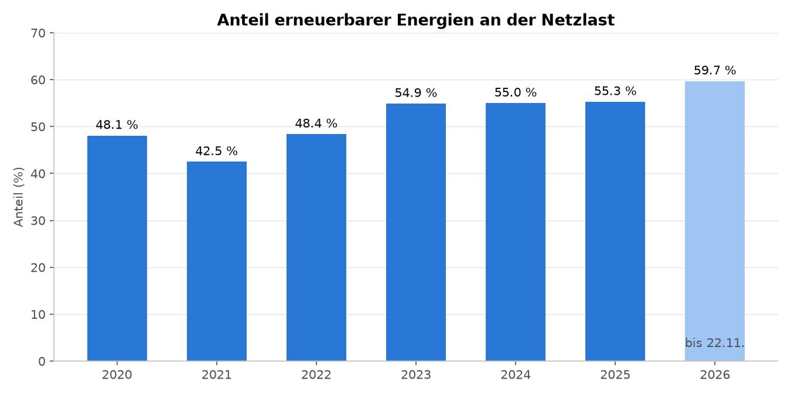
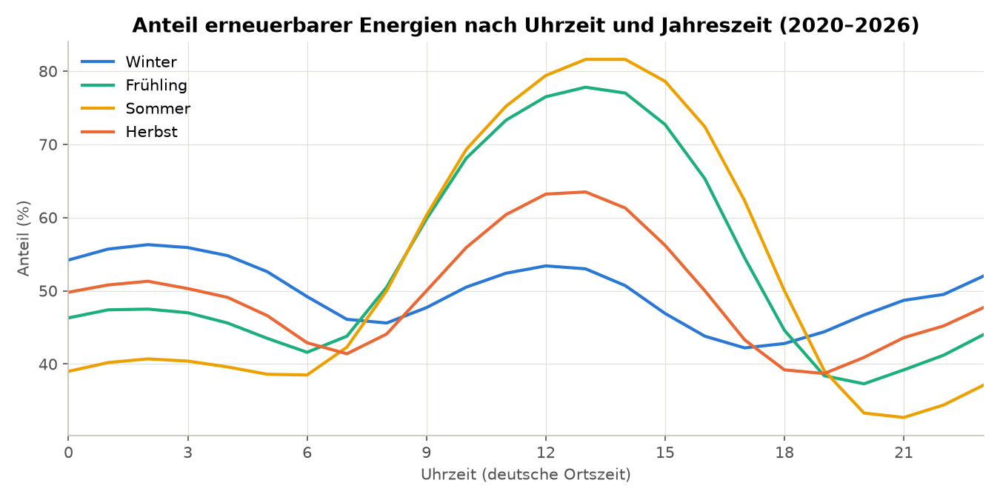
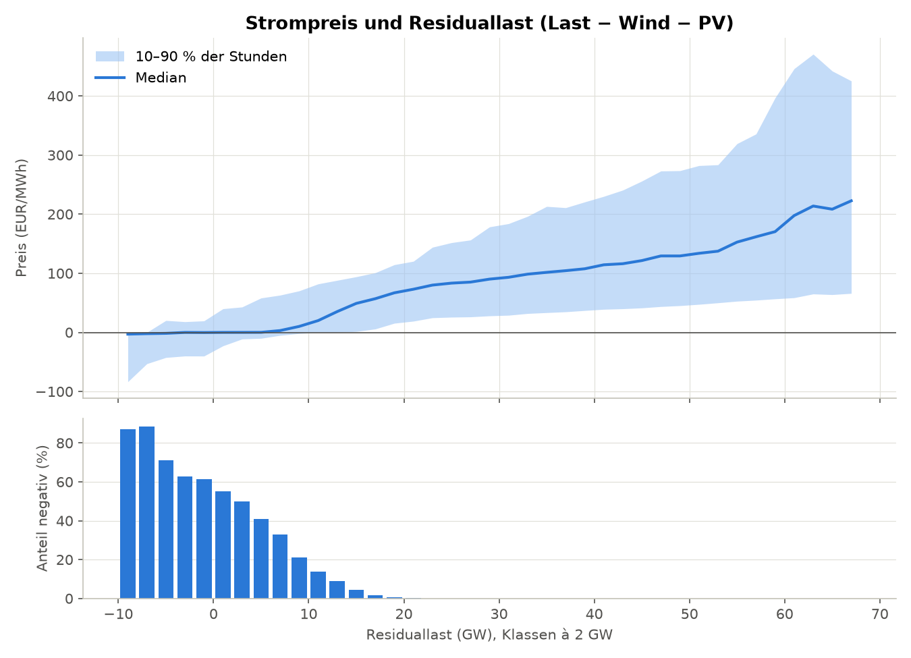
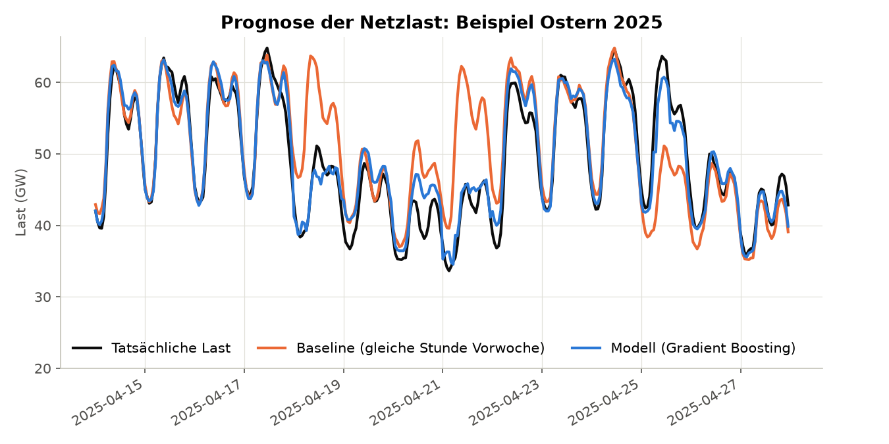

# Energiewende in Daten – Analyse des deutschen Strommarkts

Analyse von stündlichen Strommarktdaten für Deutschland (1.1.2020 – 22.11.2026) mit Python,
SQL und Machine Learning.

## Ziel

In diesem Projekt analysiere ich den deutschen Strommarkt seit 2020 mit stündlichen Daten.
Ich möchte verstehen, wie man die Energiewende in den Daten sieht: Wann gibt es viel Strom
aus Sonne und Wind? Wann sind die Strompreise negativ? Und wie gut kann man den
Stromverbrauch für den nächsten Tag vorhersagen?

## Fragen

1. **Anteil erneuerbarer Energien:** Wie hängt der Anteil von der Uhrzeit, vom Wochentag und
   von der Jahreszeit ab? Wie hat er sich seit 2020 entwickelt?
2. **Negative Strompreise:** Wann gibt es negative Preise? Welchen Zusammenhang gibt es mit der
   Residuallast (Last − Wind − PV)?
3. **Prognose der Netzlast:** Wie gut ist eine einfache Prognose für den nächsten Tag?
   Ich vergleiche eine naive Baseline (gleiche Stunde in der Vorwoche) mit einem Modell aus
   scikit-learn. Fehlermaße: MAE und MAPE.
4. **Datenqualität:** Gibt es Lücken oder Ausreißer? Wie gehe ich mit der Zeitumstellung um
   (Tage mit 23 und 25 Stunden)?

## Ergebnisse

### 1. Anteil erneuerbarer Energien



- Der Anteil an der Netzlast ist von **48 % (2020)** auf **55 % (2023–2025)** gestiegen.
  2021 war ein Jahr mit wenig Wind (42,5 %).
- 2026 ist noch nicht vollständig (bis 22.11.). Der Wert ist zu hoch, weil der Dezember fehlt
  (viel Last, wenig Sonne).
- Am Sonntag ist der Anteil höher (61 %) als am Mittwoch (48 %). Der Grund ist die
  niedrigere Last am Wochenende, nicht mehr Wind oder Sonne.



- Im Frühling und Sommer liegt der Anteil mittags über **80 %** (Photovoltaik).
- Im Winter ist die Kurve flach, und der Anteil ist **nachts** am höchsten (Wind, niedrige Last).
- In allen Jahreszeiten ist der Anteil zwischen 18 und 21 Uhr am niedrigsten: Die Sonne geht
  unter, aber die Last bleibt hoch.

### 2. Negative Strompreise



- Die Zahl der Stunden mit negativem Preis ist stark gestiegen: **69 (2022)** → **573 (2025)**.
- **76 %** dieser Stunden liegen zwischen 10 und 17 Uhr, **62 %** am Wochenende. Am häufigsten
  sind sie im Mai um 13–14 Uhr (siehe `figures/4_negative_preise_monat_uhrzeit.png`).
- Negative Preise gibt es fast nur bei niedriger Residuallast: **83 %** der negativen Stunden
  haben eine Residuallast unter 10 GW. Ist die Residuallast negativ (mehr Wind und PV als
  Last), ist der Preis in rund 70 % der Stunden negativ. Über 20 GW gibt es praktisch keine
  negativen Preise.
- Spearman-Korrelation Preis–Residuallast: **0,53**. Der Zusammenhang ist klar, aber der Preis
  hängt auch von Gas, CO₂ und Import/Export ab.

### 3. Prognose der Netzlast für den nächsten Tag

Die Prognose für Tag D wird am Tag D−1 gemacht. Deshalb nutzt das Modell nur Kalenderdaten
(Stunde, Wochentag, Monat, Feiertag) und Lastwerte, die mindestens zwei Tage alt sind.
Training: 2020–2024. Test: 1.1.2025 – 22.11.2026 (Daten, die das Modell nie gesehen hat).

| Modell | MAE | MAPE | MAPE an Feiertagen |
|---|---|---|---|
| Baseline (gleiche Stunde Vorwoche) | 2.656 MW | 5,04 % | 22,7 % |
| Gradient Boosting (scikit-learn) | **1.744 MW** | **3,32 %** | **4,5 %** |



Das Modell ist um 34 % besser als die Baseline. Der größte Unterschied ist an Feiertagen:
Die Baseline erwartet an Karfreitag einen normalen Arbeitstag und kopiert eine Woche später
den Feiertag. Das Modell kennt die Feiertage.

### 4. Datenqualität

- **Zeitumstellung:** Alle Zeitstempel sind in UTC gespeichert (eindeutig, ohne Lücken). Die
  deutsche Ortszeit gibt es als zusätzliche Spalte. Es gibt 7 Tage mit 23 Stunden und
  7 Tage mit 25 Stunden, immer am letzten Sonntag im März bzw. Oktober.
- **Lücken:** Keine fehlenden Stunden. Nur beim Preis fehlen 48 Stunden (20.–21.11.2026), auch
  in den Viertelstundenwerten. Diese Lücke fülle ich nicht, weil ich sonst Daten erfinden würde.
- **Ausreißer:** Keine negativen Werte und keine extremen Sprünge in der Last (robuster
  z-Score mit Median und MAD). Extreme Preise (−500 €/MWh am 2.7.2023, 936 €/MWh am
  12.12.2024) sind echte Marktereignisse und bleiben in den Daten.
- **Auffällig:** „Sonstige Erneuerbare“ ist 2026 oft tagelang konstant (vermutlich vorläufige
  Werte). Der Effekt ist sehr klein (unter 0,3 % der Last).
- **Kernenergie:** Nach dem Atomausstieg (15.4.2023) auf 0 gesetzt.
- **Kontrolle:** Meine Residuallast stimmt mit der Residuallast von SMARD überein
  (maximale Abweichung 16,5 MWh).

## Fazit

1. **Die Energiewende sieht man in den Daten:** Der Anteil erneuerbarer Energien ist seit 2020
   gestiegen. Er hängt aber stark von Wetter, Uhrzeit und Jahreszeit ab: mittags im Sommer
   über 80 %, am Abend und im Winter viel weniger.
2. **Negative Preise sind ein Zeichen für fehlende Flexibilität:** Sie entstehen, wenn viel
   Photovoltaik und Wind auf niedrige Last treffen (Residuallast nahe oder unter 0), vor allem
   an sonnigen Wochenenden im Frühling. Speicher und flexible Verbraucher könnten diese
   Stunden nutzen.
3. **Schon ein einfaches Modell verbessert die Lastprognose deutlich:** Mit Kalender- und
   Feiertagsinformationen sinkt der Fehler von 5,0 % auf 3,3 %. Wetterdaten (z. B. Temperatur)
   und regionale Feiertage könnten die Prognose noch verbessern.

## Daten

- **Quelle:** [SMARD](https://www.smard.de), die Strommarktdaten der Bundesnetzagentur
- **Zeitraum:** 1. Januar 2020 bis heute, stündlich, Deutschland
- **Inhalt:** Netzlast, Stromerzeugung nach Energieträger (Photovoltaik, Wind Onshore,
  Wind Offshore, Biomasse, Wasserkraft, Braunkohle, Steinkohle, Erdgas, Kernenergie u. a.)
  und Großhandelspreis Deutschland/Luxemburg
- **Download:** automatisch über die JSON-Schnittstelle von SMARD

### Lizenz und Quellenangabe

Die Marktdaten von SMARD stehen unter der Lizenz
[Creative Commons Namensnennung 4.0 International (CC BY 4.0)](https://creativecommons.org/licenses/by/4.0/deed.de).

Quelle: **Bundesnetzagentur | SMARD.de**

**Hinweis zu den Großhandelspreisen:** Laut SMARD wird die Lizenz der Großhandelspreise im
Moment rechtlich geprüft (Festlegungsverfahren HEDWIG). Bis auf Weiteres sollen diese Preise
nicht weiterverwendet werden ([SMARD – Datennutzung](https://www.smard.de/home/datennutzung)).
Deshalb enthält dieses Repository **keine Rohdaten**. Jede Person lädt die Daten selbst mit
dem Skript herunter. Zu den Preisen zeige ich nur zusammengefasste Ergebnisse.

## Projektstruktur

```
├── data/              # heruntergeladene Daten und SQLite-Datenbank (nicht im Repository)
├── figures/           # Grafiken für dieses README
├── sql/               # Datenbankschema und SQL-Abfragen
├── src/
│   ├── download.py    # Download von SMARD (mit Cache)
│   ├── clean.py       # Bereinigung und Prüfung der Datenqualität
│   ├── database.py    # SQLite-Datenbank und SQL-Abfragen
│   ├── analysis.py    # Analyse und Grafiken (Fragen 1 und 2)
│   ├── forecast.py    # Lastprognose (Frage 3)
│   └── dashboard.py   # interaktives Dashboard mit Streamlit
├── tests/             # Tests mit pytest
├── pytest.ini
├── requirements.txt
└── README.md
```

## Installation

Voraussetzung: Python 3.14 (getestet unter Windows 10)

```bash
git clone https://github.com/adriancrg/energiewende-in-daten.git
cd energiewende-in-daten
python -m venv .venv
```

Virtuelle Umgebung aktivieren:

- Windows (PowerShell): `.venv\Scripts\Activate.ps1`
- Linux/macOS: `source .venv/bin/activate`

Pakete installieren:

```bash
pip install -r requirements.txt
```

## Ausführen

Die Skripte bauen aufeinander auf. Man führt sie in dieser Reihenfolge aus:

```bash
python src/download.py     # 1. Daten herunterladen (beim ersten Mal ca. 15 Minuten)
python src/clean.py        # 2. Daten bereinigen, Bericht zur Datenqualität
python src/database.py     # 3. SQLite-Datenbank erstellen, SQL-Abfragen ausführen
python src/analysis.py     # 4. Grafiken zu den Fragen 1 und 2
python src/forecast.py     # 5. Lastprognose und Vergleich mit der Baseline
```

Dashboard starten (öffnet sich im Browser):

```bash
streamlit run src/dashboard.py
```

Im Dashboard kann man einen Zeitraum wählen und sieht Stromerzeugung, Anteil erneuerbarer
Energien, negative Preise und die Prognose für eine gewählte Woche.

Tests ausführen:

```bash
pytest
```

Die Tests prüfen unter anderem die Zeitumstellung, die Suche nach Lücken und Ausreißern,
die Berechnung von Ostern und Feiertagen, die Fehlermaße und die SQL-Abfragen.

## Werkzeuge

Python, pandas, matplotlib, SQLite, scikit-learn, Streamlit, pytest, Git

---

Entwickelt mit KI-gestützten Werkzeugen; Konzept, Analyse und Interpretation von mir.
